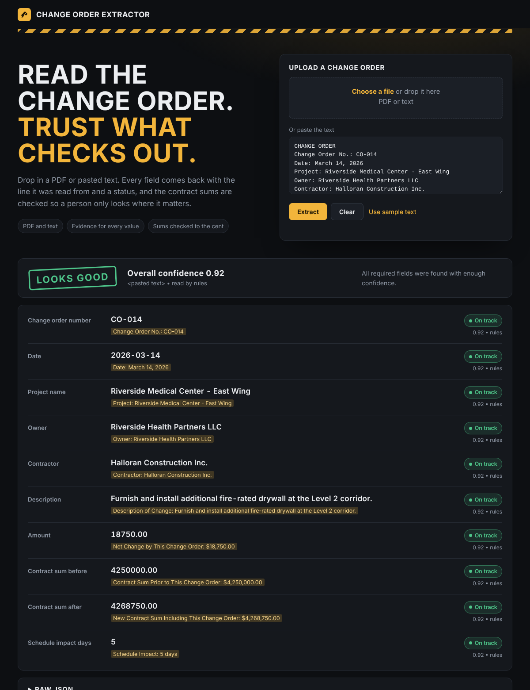
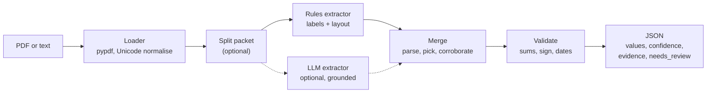
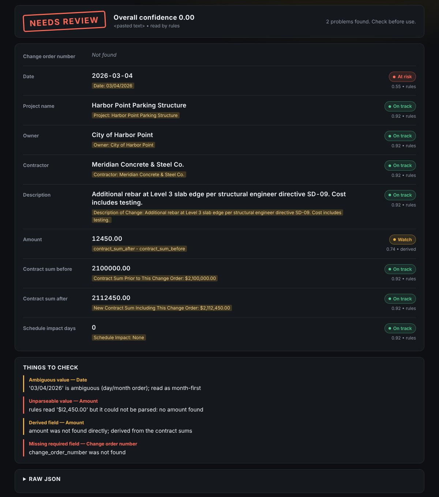

<div align="center">

# Change Order Extractor

**Messy construction change orders in. Validated JSON out, with a confidence score and the source line for every field.**

*And a straight answer to the question that matters: should a person look at this one?*

[](https://github.com/Hafsa-Anwar65/change-order-extractor/actions/workflows/ci.yml)


<br>



</div>

---

## Why it exists

Change orders arrive as PDFs and pasted text with no fixed layout, and the numbers in them move money
and schedules. Reading them is the easy half. The hard half is that **a value that is wrong but looks
confident does more damage than a value that is missing.**

So this project treats "know when not to trust the result" as the main requirement:

- every field carries a **confidence** and the **line of the document it came from**
- the contract sums are **checked to the cent** (`before + change = after`), and a mismatch is never fixed quietly
- the whole document gets a **`needs_review`** verdict, so a person only looks where it matters
- an unreadable or ambiguous value is **flagged, not guessed**

Approach, design decisions and an honest list of failure modes: **[WRITEUP.md](WRITEUP.md)**.

## How it works



| Step | What it does |
|---|---|
| **Load** | `pypdf` for PDFs, UTF-8 for text. A PDF with no text layer (a scan) raises a clear error instead of returning empty fields. |
| **Extract** | A label lexer reads values beside their labels, across columns and header-row tables, plus AIA G701 sentences. An optional Claude call (forced tool use) copes with damaged labels and new layouts. |
| **Merge** | Candidates are parsed into real types (`Decimal`, `date`, `int`). The strongest wins. Two independent extractors agreeing raises confidence, a disagreement lowers it. |
| **Validate** | Required fields, exact-decimal sum check, derived amount, sign against wording ("credit", "additional"), plausible dates. |
| **Review** | `needs_review` is true on any error, or when the weakest required field is below 0.70. |

LLM answers are never trusted on their own say-so. The value must appear in the document (otherwise
confidence is capped at 0.30), and so must the quoted evidence (otherwise 0.50). Even a fully grounded
answer stops at 0.90.

## Tech stack

| Layer | Tools | Why |
|---|---|---|
| Language |  | Modern typing and exact `Decimal` money |
| Data contract |  | The output is validated against a published JSON Schema (`co-extract --print-schema`) |
| PDF text |  | Pure Python, no system dependencies |
| Extraction | Rule-based label lexer + layout pass | Cheap, deterministic, auditable |
| LLM (optional) |  | Forced tool call, schema-validated, grounded against the source text |
| Demo and API |   | Single-page UI plus `/api/extract` |
| Quality |    | 185 tests, lint, strict types |
| CI |  | Lint, types, tests and evaluation on Python 3.12 and 3.13 |

The core runs on just `pydantic` and `pypdf`. Everything else is an extra.

## Quick start

Requires Python 3.12+.

```bash
python -m venv .venv && source .venv/bin/activate        # Windows: .venv\Scripts\activate
pip install -e ".[dev]"            # tests + web demo + LLM client

co-extract samples/co_001_clean.txt                       # rules only, no API key needed
co-extract samples/ --out-dir out/ --summary out/summary.csv   # a whole folder + a CSV overview
co-extract samples/co_010_packet.txt --split              # several change orders in one file
co-extract --print-schema                                 # JSON Schema of the output

co-extract-web                                            # demo UI at http://127.0.0.1:8000

export ANTHROPIC_API_KEY=...
co-extract samples/ --llm-fallback                        # LLM only for documents the rules doubt
co-extract samples/co_003_ocr_noise.txt --llm             # rules + LLM on every document
```

Smaller installs: the core needs only `pip install -e .`; extras are `.[web]` (demo UI and HTTP API)
and `.[llm]` (Anthropic client).

**On Windows**, double-click `activate.bat` (opens a prompt with the virtual environment active),
`run_web.bat` (starts the demo) or `run_tests.bat` (tests, lint, types and evaluation).

`--model` (or `$CO_EXTRACT_MODEL`) picks the model for the LLM. `--min-confidence` (default 0.70)
sets the bar a required field must clear before the document is considered trustworthy. Token usage
is logged with `-v`.

## Demo UI and HTTP API

`co-extract-web` serves a single page: drop a PDF or text file (or paste text) and see each field
with its confidence, the evidence it came from, any issues, and the raw JSON. A damaged document
looks like this:

<div align="center">

</div>

| Endpoint | |
|---|---|
| `POST /api/extract` | multipart upload, field `file` (15 MB max, extension allow-list) |
| `POST /api/extract-text` | `{"text": "..."}` |
| `GET /api/schema`, `GET /health` | JSON Schema, liveness |

Uploads are written to a temporary folder under a fixed name, never the client's file name. There is
no authentication; it is meant for local use or behind your own gateway.

## What you get back

Every field is `{value, confidence, evidence, method}`. Money is a string (never a float), credits
are negative, dates are ISO. Real output for the deliberately damaged sample above
(`samples/co_003_ocr_noise.txt`, shortened to three fields):

```json
{
  "source": "co_003_ocr_noise.txt",
  "extractors": ["rules"],
  "change_order": {
    "change_order_number": { "value": null, "confidence": 0.0, "evidence": null, "method": null },
    "date": {
      "value": "2026-03-04", "confidence": 0.55,
      "evidence": "Date: 03/04/2026", "method": "rules"
    },
    "amount": {
      "value": "12450.00", "confidence": 0.74,
      "evidence": "contract_sum_after - contract_sum_before", "method": "derived"
    }
  },
  "issues": [
    { "code": "ambiguous_value", "severity": "warning", "field": "date",
      "message": "'03/04/2026' is ambiguous (day/month order); read as month-first" },
    { "code": "unparseable_value", "severity": "warning", "field": "amount",
      "message": "rules read '$l2,450.00' but it could not be parsed: no amount found" },
    { "code": "derived_field", "severity": "warning", "field": "amount",
      "message": "amount was not found directly; derived from the contract sums" },
    { "code": "missing_required_field", "severity": "error", "field": "change_order_number",
      "message": "change_order_number was not found" }
  ],
  "overall_confidence": 0.0,
  "needs_review": true
}
```

The pipeline did not guess. The damaged label (`CHANGE 0RDER NO.`) and the ambiguous date are
surfaced, the unreadable amount (`$l2,450.00`) is recovered from the contract sums at lower
confidence, and the document is routed to review.

Fields: `change_order_number`, `date`, `project_name`, `owner`, `contractor`, `description`,
`amount`, `contract_sum_before`, `contract_sum_after`, `schedule_impact_days`.

### How to read the confidence

Confidence is a **routing signal, not a probability.** It comes from simple, explainable rules, so
clean documents show the same value on most fields.

| Situation | Confidence |
|---|---|
| Value found beside its primary label | 0.92 |
| Weaker or alternative label | 0.72 |
| Value on the line after its label | minus 0.05 |
| AIA G701 sentence ("will be decreased by ... $8,400.00") | 0.85 |
| Derived from other fields | x 0.8 |
| Ambiguous (for example `03/04/2026`) | x 0.6 |
| Two strong candidates disagree | x 0.6 |
| An independent extractor agrees | raised, never above 0.99 |

## Using it as a library

```python
from pathlib import Path
from co_extract import build_pipeline

pipeline = build_pipeline(use_llm=False)
result = pipeline.run_file(Path("samples/co_001_clean.txt"))
print(result.change_order.amount.value, result.needs_review)
```

`ChangeOrderPipeline` takes any objects that satisfy the small `Extractor` protocol, so adding an
extractor (layout-aware, a different model) does not touch the rest of the code.

## Tests and evaluation

```bash
pytest                                          # 185 tests, no network or API key needed
ruff check . && ruff format --check . && mypy
python -m co_extract.evaluation --corpus 1000   # samples + 1000 generated documents
```

| | Hand-written samples | Generated corpus |
|---|---|---|
| Documents | 9 (text, a real PDF file, several layouts) | 1000 (seed 7, four layouts) |
| Fields correct | 89 / 90 (98.9%) | 9954 / 10000 (99.5%) |
| Wrong values | 0 | 2 |
| Missing values | 1 | 44 |
| `needs_review` as expected | 9 / 9 | 977 / 1000 |
| Wrong values in documents **not** flagged | **0** | **0** |

The generator varies layout, date format and money format, and in 15% of documents damages a money
figure with a character swap such as `$l2,450.00`. All wrong and missing values sit inside the
documents that were flagged for review.

### What this does not show

- **It is not a real-world accuracy number.** The documents and the extractor were written by the
  same author, so this shows the pipeline behaves as designed. It has not been scored on a real,
  independently labelled set of change orders.
- **Confidence is not calibrated.** It takes few distinct values, so the calibration table in the
  evaluation shows ranking, not fine-grained probabilities.
- **The LLM path is tested against a fake client and a local stub of the API**, not a live model.
- **Scanned and handwritten documents are out of scope.** Only text and PDFs with a text layer are read.

## Where it breaks

| Failure | What happens |
|---|---|
| Scanned PDF or image | Clear error, no guessing |
| Damaged label (`0RDER`) or digits (`$l2,450.00`) | Not guessed; the document goes to review |
| Ambiguous date (`03/04/2026`) | Flagged and sent to review |
| Same field twice with different values | Lower confidence and a warning; the first value is chosen, which may not be the latest |
| LLM quotes a real but wrong span | Passes grounding, since grounding proves the text exists, not that it is the right text |

The full list of 15 failure modes, with what the pipeline does about each, is in **[WRITEUP.md](WRITEUP.md)**.

## Project layout

```
src/co_extract/
  schema.py        output contract (pydantic)
  fields.py        one FieldSpec per field: labels, parser, fallbacks, required?   <- add fields here
  normalize.py     pure parsers: money, dates, days, text
  loader.py        pdf / txt -> normalised text (scanned PDFs raise a clear error)
  segment.py       split a packet into one text per change order
  extractors/      labels.py + layout.py + rules.py (layout-aware label lexer), llm.py (grounded LLM)
  merge.py         candidates -> one value + confidence per field
  validation.py    cross-field checks, derived amount, needs_review
  pipeline.py      orchestration (+ LLM fallback)     cli.py  command line     web.py  API + demo
  corpus.py        seeded synthetic corpus generator
  evaluation.py    scoring, silent errors, calibration table
samples/           hand-written change orders (text, PDF, packet) + expected/*.json
scripts/           regenerate the sample PDF
tests/             185 tests
docs/              screenshots used in this README
.github/workflows/ci.yml   ruff, mypy, pytest, evaluation on 3.12 and 3.13
```

## What I would do next

1. Score it on a labelled set of real change orders and calibrate the confidences against it.
2. Run the LLM path against the live model and measure what `--llm-fallback` recovers per dollar.
3. Learn from reviewer corrections: grow the label list and tune the weights.
4. OCR for scanned documents, if they turn out to matter.
